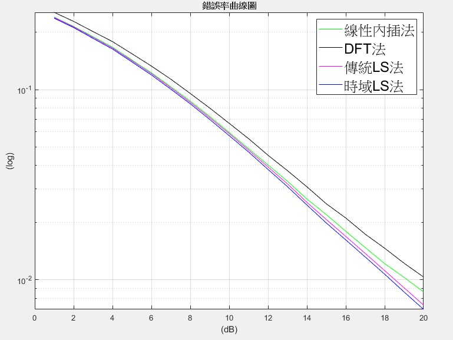
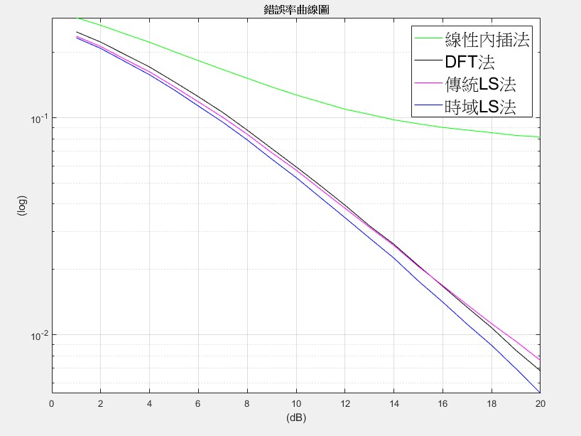
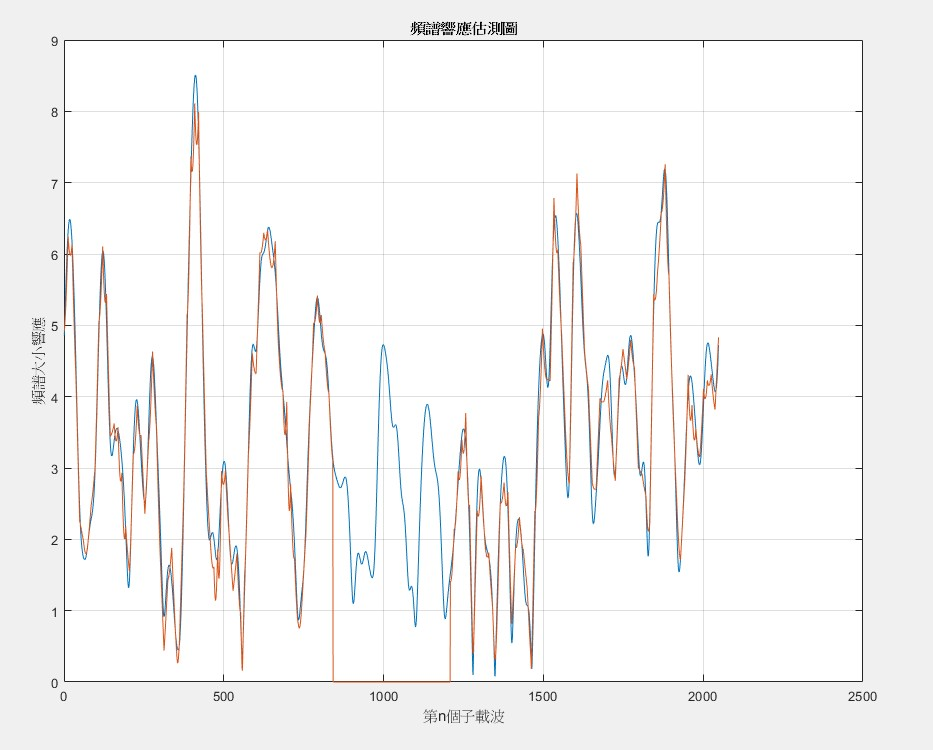
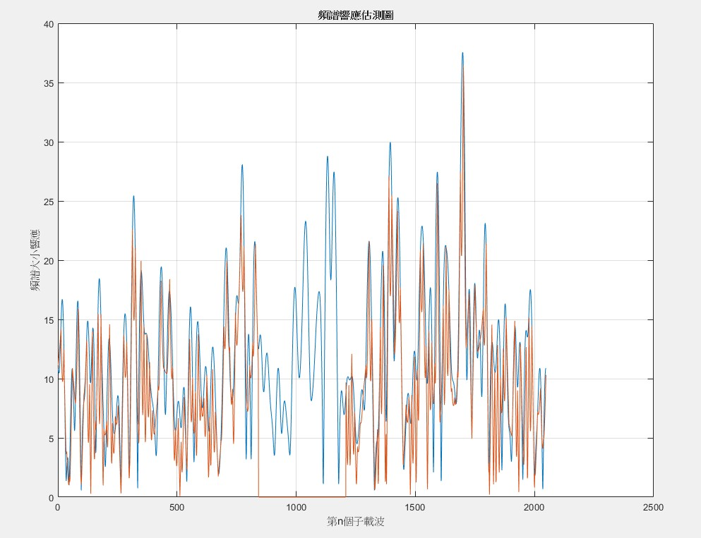
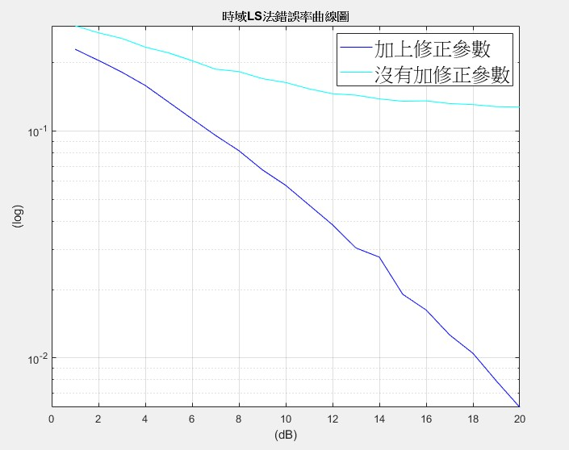
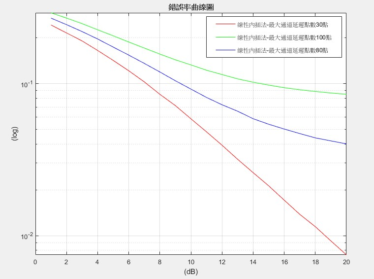
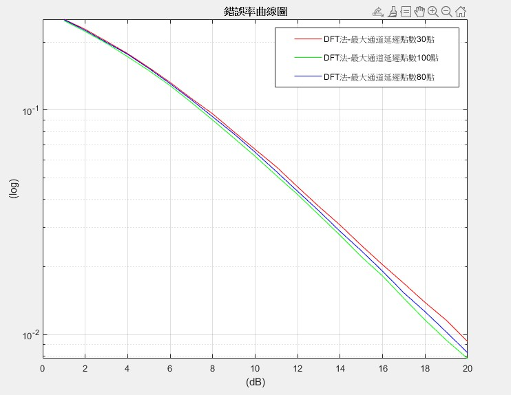
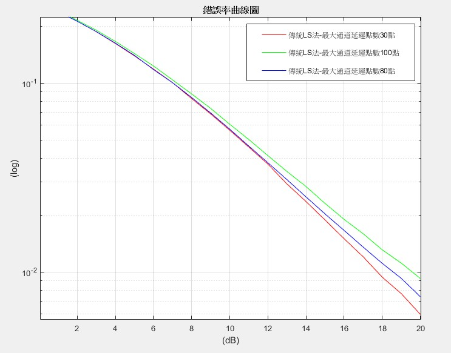
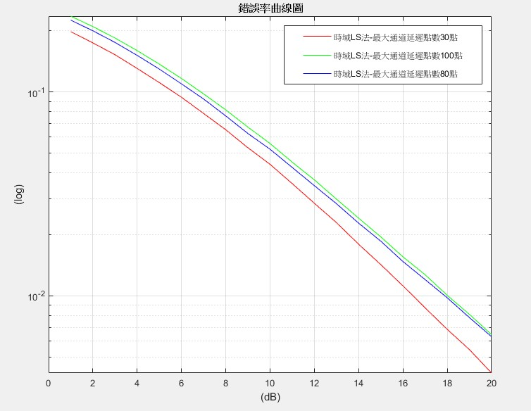

# OFDM 系統通道估測

大學專題研究：以 MATLAB 模擬 OFDM 系統在多路徑衰減通道下的通道估測，比較 **線性內插法、DFT 法、傳統 LS 法、時域 LS 法** 四種方法的位元錯誤率（BER）表現，並探討通道最大延遲點數與修正參數對估測效能的影響。

## 研究重點

- **時域 LS 法表現最佳**：在不同衰減係數與通道延遲下，皆有四種方法中最低的 BER。
- **修正參數必要性**：通道延遲點數越大，LS 矩陣越接近奇異，求反矩陣時數值不穩定；不加修正參數時 BER 會卡在約 10⁻¹，加上後可降至 10⁻³ 等級。
- **線性內插法對通道延遲最敏感**：通道延遲越長、頻率選擇性越強，越容易出現錯誤平台；DFT 法與 LS 法則相當穩定。

## 系統架構

```
QPSK 調變 → 插入領航信號 → IFFT → 加入循環字首 (CP)
        → 多路徑通道 + AWGN
        → 移除 CP → FFT → 通道估測 → 等化 → 判決 → 計算 BER
```

## 模擬參數

| 參數 | 數值 |
| --- | --- |
| FFT 點數 N | 2048 |
| 循環字首 CP | 128 |
| 每次模擬 OFDM 符元數 | 20 |
| 調變方式 | QPSK |
| 使用子載波 | 第 1–841 與 1209–2048 個子載波（中間 842–1208 為保護頻帶） |
| 領航信號 | 每 12 個子載波放置 1 個，共 141 個（71 + 70） |
| 資料子載波 | 1540 個 |
| 通道模型 | 通道點數為 L 的多路徑通道（通道脈衝響應 h[0] ~ h[L−1]），每個通道點為複高斯隨機變數並乘上指數衰減包絡 `exp(-α·n)` |
| 衰減係數 α | 0.05（能量集中在前幾個通道點）/ 0.001（各通道點能量接近，頻率選擇性強） |
| 通道最大延遲點數 L | 30 / 80 / 100 點 |
| SNR 範圍 | 1–20 dB |

## 通道估測方法

1. **線性內插法（Linear Interpolation）**
   計算領航子載波的頻率響應 `H_p = Y_p / X_p`，再對相鄰領航之間的子載波做線性內插，得到完整頻率響應。

2. **DFT 法（DFT-based）**
   將領航位置的 `H_p` 做 IFFT 轉到時域，只保留前段有效的通道點、其餘補零（去除雜訊項），再 FFT 回頻域得到完整頻率響應。

3. **傳統 LS 法（頻域）**
   以部分 DFT 矩陣 `F`（大小 141 × Le，只取領航子載波所在的列）建立 `H_p = F·h` 的關係，求解

   `ĥ = (Fᴴ F + λI)⁻¹ Fᴴ H_p`

4. **時域 LS 法**
   將只含領航信號的符元經 IFFT 後做 0 ~ L−1 點的循環位移，組成矩陣 `X̄`，直接在時域對接收信號求解

   `ĥ = (X̄ᴴ X̄ + λI)⁻¹ X̄ᴴ y`


## 檔案說明

| 檔案 | 內容 |
| --- | --- |
| `OFDM_100p_channel.m` | 主程式：最大延遲 100 點通道下，比較四種估測方法（含時域 LS 有無修正參數）的 BER |
| `OFDM_30p_channel.m` | 同上，通道最大延遲改為 30 點 |
| `Interpolation_DFT_LS.m` | 早期版本：比較線性內插、DFT、傳統 LS 三種方法 |
| `LS_LS2.m` | 比較傳統 LS 與時域 LS 在通道最大延遲 100 / 80 / 30 點時的 BER |
| `LS2_different_parameter.m` | 時域 LS 法在不同修正參數（10⁻¹ ~ 10⁻⁶）下的效能比較 |

## 執行方式

1. 使用 MATLAB 開啟任一 `.m` 檔（不需額外工具箱）。
2. 直接執行，完成後繪出 BER 對 SNR 的曲線圖。
3. 由於每次模擬的資料與通道皆為隨機產生，結果曲線會略有差異。

> 註：主程式包含 20 個通道 × 20 個 SNR 點的迴圈，且時域 LS 需要做矩陣反運算，執行時間可能需要數分鐘。

## 模擬結果

### 1. 四種估測方法 BER 比較

> 程式碼：[`OFDM_100p_channel.m`](OFDM_100p_channel.m)（最大通道延遲 100 點；衰減係數 α 可在通道產生處 `g = exp(-α*[0:99]).*n` 修改）

| 衰減係數 α = 0.05 | 衰減係數 α = 0.001 |
| :---: | :---: |
|  |  |

- **α = 0.05**：通道能量集中在前幾個通道點，頻率響應變化平緩，四種方法表現接近；時域 LS 法略佳，DFT 法略差。
- **α = 0.001**：各通道點能量相近，通道頻率選擇性強。線性內插法無法追上快速變化的頻率響應，BER 在高 SNR 時出現約 8×10⁻² 的錯誤平台；DFT 法與 LS 法仍能隨 SNR 下降，其中**時域 LS 法表現最好**（20 dB 時約 5×10⁻³）。

### 2. 頻率響應估測

| 衰減係數 α = 0.05 | 衰減係數 α = 0.001 |
| :---: | :---: |
|  |  |

藍線為真實通道頻率響應，橙線為估測結果。中間第 842–1208 個子載波為保護頻帶（不傳送資料），因此不需估測。α = 0.001 時通道起伏劇烈得多，估測難度也較高。

### 3. 時域 LS 法：修正參數有無之比較

<p align="center">
  
</p>

由於保護頻帶使可用的領航信號有限，當通道延遲點數越大，時域 LS 的矩陣 `X̄ᴴX̄` 越接近奇異，求反矩陣時數值不穩定。不加修正參數時，BER 停留在約 1.3×10⁻¹ 幾乎不再下降；加上修正參數 λ 後，20 dB 時 BER 可降至約 6×10⁻³，可見修正參數對此方法非常關鍵。

### 4. 不同最大通道延遲點數之比較（30 / 80 / 100 點）

| 線性內插法 | DFT 法 |
| :---: | :---: |
|  |  |
| **傳統 LS 法** | **時域 LS 法** |
|  |  |

- **線性內插法**對通道延遲最敏感：30 點時 20 dB 的 BER 約 7.5×10⁻³，80 點升至約 4×10⁻²，100 點則出現約 8.5×10⁻² 的錯誤率。通道延遲越長，頻率響應變化越快，領航間距 12 個子載波已不足以靠線性內插追上。
- **DFT 法**幾乎不受通道延遲影響，三條曲線非常接近（20 dB 時約 8×10⁻³ ~ 1×10⁻²）。
- **傳統 LS 法**與**時域 LS 法**皆是通道點數越少、BER 越低，但差距不大，三種延遲下都能隨 SNR 持續下降；其中時域 LS 法在 30 點時表現最佳（20 dB 時約 4.5×10⁻³）。

### 結論

- 通道頻率選擇性低（衰減快或延遲短）時，簡單的線性內插即可有不錯效果；頻率選擇性高時則應採用 DFT 或 LS 類方法。
- DFT 法與兩種 LS 法對最大通道延遲點數的變化都相當穩健，線性內插法則會隨延遲增加而迅速劣化。
- 時域 LS 法在各種通道條件下皆有最佳 BER 表現，但必須搭配適當的修正參數。

## 作者

- 張茲逸｜長庚大學 電機工程學系
- 指導教授：高永安 教授
